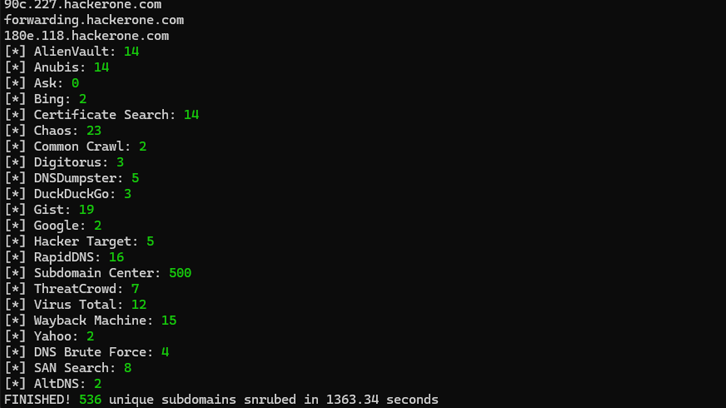


<h1 align="center">
  
  <br>
</h1>

<p align="center">
🍩
  <a href="#key-features">Key Features</a> •
  <a href="#how-to-use">How To Use</a> •
  <a href="#installation">Installation</a> •
  <a href="#acknowledgements">Acknowledgements</a>
🍺
</p>

<h1 align="center">
  
  <br>
</h1>

## Key Features
- 19 sources, all keyless (no subscriptions required)
- Asyncronous brute force with lots of pep, 3,000+ requests/s (depending on resolvers and network performance)
- Mutation brute forcing, i.e. permutations of discovered domains then used in a brute force
- Recursive brute forcing
- Wildcard subdomain evasion
- TLS certificate Subject Alternative Name (SAN) enumeration
- Linux & Windows supported


#### Sources
~~[AlienVault](https://otx.alienvault.com/)~~, [Anubis](https://github.com/jonluca/Anubis), ~~[Ask](https://www.ask.com/)~~, ~~[Bing](https://www.bing.com/)~~, [Cert Spotter](https://certspotter.com/), [Certificate Search](https://crt.sh/), [Chaos](https://chaos.projectdiscovery.io/), [Common Crawl](https://commoncrawl.org/), ~~[Digitorus](https://www.digitorus.com/)~~, [DNSDumpster](https://dnsdumpster.com/), [DNSRepo](https://dnsrepo.noc.org/), ~~[DuckDuckGo](https://duckduckgo.com/)~~, [Gist](https://gist.github.com/), ~~[Google](https://www.google.com)~~, [Hacker Target](https://hackertarget.com/), [Hudson Rock](https://www.hudsonrock.com/), [Netlas](https://app.netlas.io/), [RapidDNS](https://rapiddns.io/), [Robtex](https://robtex.com/), [ARPSyndicate](https://www.subdomain.center/), ~~[ThreatCrowd](http://ci-www.threatcrowd.org/)~~, [THC](https://ip.thc.org/), [URLScan](https://urlscan.io/), [VirusTotal](https://www.virustotal.com/), [WayBack Machine](https://archive.org/web/), [Yahoo](https://yahoo.com/)

## How To Use
```
usage: snrublist3r.py [-h] [-d DOMAIN] [-df DOMAINS_FILE] [-s SOURCES]
                      [--fast] [--proxy PROXY] [--disable-scraping] [-b]
                      [-sf SUBDOMAINS_FILE] [-rf RESOLVERS_FILE]
                      [--tasks TASKS] [--timeout TIMEOUT]
                      [--dns-retries DNS_RETRIES] [-we] [-m]
                      [-pf PERMUTATION_FILE] [-ap] [-ma MAX_ALTS] [-r]
                      [-rd RECURSIVE_DEPTH] [--recursive-file RECURSIVE_FILE]
                      [--san] [-fs FILTER_STRING] [--loop] [-o OUTPUT_FILE]
                      [-v] [--debug] [--silent]

optional arguments:
  -h, --help            show this help message and exit

TARGET(S):
  -d DOMAIN, --domain DOMAIN
                        root domain
  -df DOMAINS_FILE, --domains-file DOMAINS_FILE
                        input file of line-separated root domains

SCRAPING:
  -s SOURCES, --sources SOURCES
                        comma-separated list of sources, options are anubis,
                        certificatesearch, certspotter, chaos, commoncrawl,
                        dnsdumpster, dnsrepo, gist, hackertarget, hudsonrock,
                        netlas, rapiddns, robtex, subdomaincenter, thc,
                        urlscan, virustotal, waybackmachine, yahoo (default is
                        all)
  --fast                run only fast scraping modules (excludes Common Crawl,
                        Gist, Robtex, Wayback Machine)
  --proxy PROXY         proxy used for source scraper, e.g.
                        'http://127.0.0.1:8080'
  --disable-scraping    disable scraping of any sources (use with brute force
                        options)

BRUTE FORCE:
  -b, --brute-force     enable raw brute force
  -sf SUBDOMAINS_FILE, --subdomains-file SUBDOMAINS_FILE
                        input file of line-separated subdomains used in the
                        DNS brute force (default is combined_subdomains.txt)
  -rf RESOLVERS_FILE, --resolvers-file RESOLVERS_FILE
                        input file of line-separated resolver IPs used in the
                        DNS brute force
  --tasks TASKS         number of concurrent tasks in the brute-force and SAN-
                        search queues (default is 256)
  --timeout TIMEOUT     timeout on DNS resolution and SAN search (default is
                        3)
  --dns-retries DNS_RETRIES
                        retries for DNS resolution (default is 1)
  -we, --wildcard-evasion
                        raw and mutation brute force domains resolving to
                        wildcard domain IPs will be filtered
  -m, --mutation        enable mutation brute force
  -pf PERMUTATION_FILE, --permutation-file PERMUTATION_FILE
                        input file of line-separated strings used in the
                        mutation DNS brute force (default is permutation-
                        strings.txt)
  -ap, --autopilot      ignore input() prompts
  -ma MAX_ALTS, --max-alts MAX_ALTS
                        mutation resolution cap (generated mutations exceeding
                        this are truncated), default is 1,000,000
  -r, --recursive       enable recursive brute force
  -rd RECURSIVE_DEPTH, --recursive-depth RECURSIVE_DEPTH
                        recursion depth for the recursive brute force (default
                        is 1)
  --recursive-file RECURSIVE_FILE
                        input file of line-separated words used under
                        discovered subdomains in the recursive brute force
                        (default is subdomains-top500.txt)

SAN SEARCH:
  --san                 enable Subject Alt Names search

FILTERING:
  -fs FILTER_STRING, --filter-string FILTER_STRING
                        filter domains from processing containing
                        specified case-insensitive string(s)
                        (-fs ".foo.,.bah.")

CONFIGURATIONS:
  --loop                run in a continuous loop

OUTPUT:
  -o OUTPUT_FILE, --output OUTPUT_FILE
                        output file to save results

VERBOSITY:
  -v                    enable verbosity
  --debug               enable debug log level
  --silent              disable terminal output
```


#### Example Usage
##### Fast
```
python snrublist3r.py -d example.com -v --fast
```

##### Filtering
```
python snrublist3r.py -d example.com -v --fast -fs ".crm." -fs ".foo."
```

##### Comprehensive
```
python snrublist3r.py -d example.com -v --brute-force --mutation --wildcard-evasion --recursive --san
```

##### Brute Force only
```
python snrublist3r.py -d example.com -v -b -m --disable-scraping
```

🧠 _Note: The system DNS resolver will be used by default, so in the interests of going fast and not DoS'ing yourself it's recommended to not do this and instead use the_ `--resolvers-file` _option with the provided ./lists/top-resolvers.txt, this will rotate through Cloudflare, Google, OpenDNS, and Quad9 DNS resolvers._

## Installation

**Python 3.9.0+** is recommended for use of removeprefix() function

#### Linux
```
git clone https://github.com/b3n-j4m1n/snrublist3r.git
cd snrublist3r
python -m venv snrublist3r
source ./snrublist3r/bin/activate
pip install -r requirements.txt
```

#### Windows
```
git clone https://github.com/b3n-j4m1n/snrublist3r.git
cd snrublist3r
python -m venv snrublist3r
.\snrublist3r\Scripts\Activate.ps1
pip install -r requirements.txt
```

## Acknowledgements
 - [Async DNS Brute](https://github.com/blark/aiodnsbrute) for the reference material for a fast as f*ck asynchronous DNS brute force.
 - [AltDNS](https://github.com/infosec-au/altdns) for the subdomain mutation module.
 - [SecLists](https://github.com/danielmiessler/SecLists) for the wordlists.
 - [resolvers](https://github.com/trickest/resolvers) for the resolvers.
 - [Sublist3r](https://github.com/aboul3la/Sublist3r), a brilliant tool with lots of well-thought-out, practical ideas. It is ensuring the financial security of bug hunting for years to come.